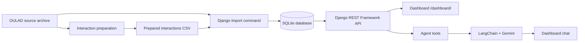

# OULA — Student Success and Engagement Analytics

OULA is a student learning analytics application built with Django and the **Open University Learning Analytics Dataset (OULAD)**. It helps a teaching team explore student engagement and academic outcomes, review transparent early-warning indicators, and ask natural-language questions about the data.

The project was developed for **Project 10** in the Master 2 Data Science Python Web Development course. Its intended users are teaching staff who need a clear overview of course outcomes and student activity.

## Project status

| Workstream | Status |
|---|---|
| Repository setup and architecture | Completed |
| OULAD inspection and data-quality audit | Completed for the audited source archive; some grouped missingness analyses remain open |
| Interaction preparation and reconciliation | Completed and validated |
| Django models, migrations, and controlled import | Completed and validated locally |
| Read-only REST API and course-level analytics | Implemented |
| Early-withdrawal risk indicators and retrospective check | Implemented; validation is limited to one course presentation and cutoff |
| Interactive dashboard | Implemented |
| Data-grounded conversational agent | Implemented; requires a configured external Gemini API |
| Automated tests | Implemented; run locally with the command below |

## What the application does

- Imports OULAD data into a relational Django database.
- Exposes course, student, enrollment, assessment, and analytical endpoints through Django REST Framework.
- Summarizes course success, withdrawal, and recorded VLE activity.
- Calculates a transparent rule-based risk score at a selected course-day cutoff.
- Displays course-level charts, engagement trends, risk indicators, and a retrospective comparison with final outcomes.
- Provides a LangChain assistant that calls the project's API tools and answers questions using the returned data.

The risk score is an **exploratory decision-support indicator**, not a trained predictive model and not a verdict about an individual student.

## Architecture



The dashboard and the agent consume the same project API. Their results should therefore agree when they use the same module, presentation, cutoff, and metric definition.

| Component | Technology |
|---|---|
| Backend | Django 5.2 |
| REST API | Django REST Framework |
| Development database | SQLite |
| Dashboard | Django templates and Chart.js |
| Conversational agent | LangChain and Google Gemini |
| Data preparation and analysis | Python, pandas, NumPy |
| Tests | Django test framework and DRF API test client |

## Dataset and data model

OULAD contains seven related CSV files: `studentInfo.csv`, `studentRegistration.csv`, `courses.csv`, `assessments.csv`, `studentAssessment.csv`, `vle.csv`, and `studentVle.csv`.

- [Official OULAD dataset page](https://analyse.kmi.open.ac.uk/open_dataset)
- [Kaggle mirror](https://www.kaggle.com/datasets/rocki37/open-university-learning-analytics-dataset)

A course in this project is a **module presentation**, uniquely identified by `code_module` and `code_presentation`. A student can have multiple enrollments. OULAD dates are relative day offsets, not calendar dates; negative offsets can be valid.

The Django application uses five main models:

| Model | Purpose |
|---|---|
| `Student` | An anonymized student identity and person-level attributes |
| `Course` | One module presentation |
| `Enrollment` | One student's participation in one module presentation |
| `Assessment` | An assessment record associated with an enrollment |
| `Interaction` | Aggregated VLE clicks for one enrollment, resource, and relative day |

The `Enrollment` model is essential: outcomes and attributes can vary across course presentations for the same student, and assessments and interactions must be associated with the correct enrollment.

See [the architecture](docs/architecture.md) and [the data dictionary](docs/data-dictionary.md) for details.

## Data preparation and validation

The raw archive is preserved unchanged. The interaction preparation script:

1. Removes only exact duplicate source rows.
2. Groups the remaining records by student, module presentation, VLE resource, and relative day.
3. Sums `sum_click` within each group to produce `total_clicks`.

For the audited archive:

| Stage | Rows |
|---|---:|
| Raw `studentVle.csv` rows | 10,655,280 |
| After exact duplicate removal | 9,868,110 |
| After aggregation at the agreed interaction grain | 8,459,320 |

The database import validation recorded 22 course presentations, 28,785 students, 32,593 enrollments, 173,912 assessment records, and 8,459,320 interaction records. The imported click total (38,343,063) reconciled with the prepared interaction data.

These figures describe the specific archive audited by the team. Rerun the preparation and validation steps if the source data or transformation changes.

Our missing-data policy is **preserve → investigate → document → handle at point of use**. A missing assessment score is not zero; a missing unregistration date does not by itself establish whether or when a student withdrew. See [Data Quality Decisions](docs/data-quality.md) and [Data Quality and Missing-Value Policy](docs/data-quality-and-missing-values.md).

## Analytics and metric definitions

The project exposes two success-rate definitions for different questions. They are not directly comparable:

| Endpoint | Definition |
|---|---|
| `/api/analytics/success-rate-by-course/` | Pass + Distinction divided by completed outcomes (Pass + Distinction + Fail). Withdrawals are reported separately and excluded from the denominator. |
| `/api/stats/reussite-par-cours/` | Pass + Distinction divided by all enrollments, including Withdrawn outcomes. The withdrawal rate is also calculated over all enrollments. |

Engagement indicators describe recorded platform activity. They are not direct measurements of attention, learning, or effort. Differences and correlations between activity and outcomes do not establish causation. Students who withdraw may have had less time to generate clicks.

## Early-withdrawal risk indicators

The risk endpoint calculates an additive score at a selected day cutoff (day 60 by default). It uses recorded activity and assessment information available up to that cutoff; the final outcome is attached for retrospective comparison, not used as a score input.

The implemented signals include no recorded clicks, activity below a course-level lower-quartile threshold, no recent activity in the preceding 14 days, no recorded non-missing assessment score by the cutoff, and low or moderate average scores. Risk levels are high (60 or more), medium (30–59), and low (below 30).

**Implementation note:** the score is additive and is not capped in the current code. Under the current rules it can exceed 100, despite earlier documentation describing it as a 0–100 score. This should be resolved in the scoring implementation or its specification before the score is presented as a percentage or normalized scale.

The retrospective endpoint compares risk levels with final outcomes. The documented example covers module AAA, presentation 2013J, at day 60: 361 enrollments were analyzed. The proportion who ultimately failed or withdrew was 85.7% in the high-risk group (7 students), 64.3% in the medium-risk group (28 students), and 18.1% in the low-risk group (326 students), compared with 23.0% overall.

This is a limited descriptive check, not a general performance estimate. It covers one course presentation and one cutoff; the high- and medium-risk groups are small. The implementation also needs a stricter eligibility check for students whose registration date is missing or later than the selected cutoff. See [API, Dashboard, and Agent](docs/api-dashboard-agent.md) for the implementation details and limitations.

## Dashboard

Open `/dashboard/` after starting the Django development server. The dashboard includes:

- Overall enrollment, success-rate, and withdrawal-rate cards.
- Success and withdrawal rates by module.
- Weekly VLE clicks for a selected module.
- Mean and median clicks by final outcome, with a warning about exposure-time differences.
- A risk table filtered by module, presentation, cutoff day, and risk level.
- A retrospective risk-validation summary.
- A chat interface for the conversational assistant.

Chart.js is loaded by the dashboard from a CDN, so the browser needs internet access to retrieve that library.

## Conversational agent

The LangChain agent has three tools that call the project's API:

1. Success and withdrawal statistics by module.
2. Weekly engagement for a selected module.
3. Students flagged by the rule-based risk indicator.

The agent is instructed to ground answers in tool results, ask for missing course context, explain the reasons returned for risk flags, and avoid presenting a risk score as a verdict. The configured primary Gemini model is tried first, followed by the fallback models in `.env`.

The agent requires a valid Google AI Studio API key and a running Django server. Model identifiers and provider availability can change; use model names currently supported by Google AI Studio.

## Installation and local run

The commands below use Windows PowerShell. On macOS or Linux, activate the virtual environment with `source .venv/bin/activate`.

1. Clone the repository and create a virtual environment:

   ```powershell
   git clone https://github.com/RosAI-27/OULA-DjangoProject.git
   cd OULA-DjangoProject
   python -m venv .venv
   .venv\Scripts\Activate.ps1
   pip install -r requirements.txt
   ```

2. Install the additional agent dependencies if they are not already included in your local environment:

   ```powershell
   pip install requests langchain langchain-google-genai
   ```

3. Copy `.env.example` to `.env` at the repository root. Set a local Django secret, allowed hosts, a Google AI Studio API key, and model identifiers supported by your account. **Never commit `.env` or real credentials.**

   Generate a local Django secret with:

   ```powershell
   python -c "import secrets; print(secrets.token_urlsafe(50))"
   ```

4. Place the OULAD archive at `data/raw/OULA.zip`. It must contain the original `anonymiseddata/` directory. The `data/` directory is not versioned.

5. From the repository root, prepare the interactions:

   ```powershell
   python scripts/prepare_interactions.py --input data/raw/OULA.zip --output data/processed/interactions.csv
   ```

6. From the `backend` directory, apply migrations and import the data:

   ```powershell
   cd backend
   python manage.py migrate
   python manage.py import_oulad
   ```

   The import command stops if the database already contains data. The `--replace` option deletes existing imported data before re-importing; use it carefully. Importing the interactions can take several minutes.

7. Start the server:

   ```powershell
   python manage.py runserver
   ```

8. Open [http://127.0.0.1:8000/dashboard/](http://127.0.0.1:8000/dashboard/).

Keep the Django server running while using the agent, because its tools call the local API.

## API overview

All endpoints are under the `/api/` prefix. The original French URL paths and response field names are retained for compatibility with the existing dashboard and agent.

| Method | Endpoint | Purpose |
|---|---|---|
| GET | `/api/courses/` | List course presentations |
| GET | `/api/students/` | List anonymized student records |
| GET | `/api/enrollments/` | List enrollments and final outcomes |
| GET | `/api/assessments/` | List assessment records |
| GET | `/api/analytics/engagement-by-course/` | Aggregate clicks, active enrollments, and interaction records by course presentation |
| GET | `/api/analytics/success-rate-by-course/` | Success rate among completed outcomes |
| GET | `/api/stats/reussite-par-cours/` | Dashboard success and withdrawal rates |
| GET | `/api/stats/engagement-par-semaine/` | Weekly clicks and active-enrollment counts |
| GET | `/api/stats/engagement-par-resultat/` | Mean and median clicks by final outcome |
| GET | `/api/etudiants-a-risque/` | Risk scores and explanations for a selected course presentation |
| GET | `/api/etudiants-a-risque/validation/` | Retrospective comparison of risk levels with final outcomes |
| POST | `/api/agent/ask/` | Ask the conversational agent; JSON body: `{"question": "..." }` |

The course, student, enrollment, and assessment list endpoints use Django REST Framework's default pagination (20 records per page in the current settings). The current code applies filters as implemented in the corresponding views; consult `backend/analytics/views.py` for the supported query parameters.

**Access-control limitation:** the current Django REST Framework settings do not configure authenticated default permissions, and the relevant views do not add them. Do not assume that student-level endpoints are protected. The API and dashboard should be treated as development-only until authentication and authorization are implemented and tested.

## Development challenges and how we addressed them

This project required more than connecting Django to a CSV file. The main challenges included:

- **Handling a very large interaction table.** The raw VLE file contains more than 10 million rows. We kept the source archive unchanged and used a reproducible preparation script instead of creating millions of ORM objects one by one.
- **Distinguishing duplicates from repeated observations.** Exact duplicate rows were removed, but records sharing the same student-resource-day key were aggregated by summing clicks. This avoided discarding valid click counts.
- **Choosing the correct data grain.** A course is a module presentation, and student outcomes and attributes can vary across enrollments. The separate Enrollment model preserves those relationships.
- **Investigating missing values.** Missing scores, registration dates, and unregistration dates do not all mean the same thing. We documented their patterns and avoided treating missing scores as zero or missing dates as proof of withdrawal.
- **Reconciling imported data.** We checked row counts, unique keys, and click totals between the prepared file and the Django database.
- **Building analytics on top of a large dataset.** We used aggregate ORM queries and API endpoints instead of exposing millions of raw interaction rows to the dashboard.
- **Keeping interpretation honest.** We distinguished completed-outcome success rates from all-enrollment success rates, documented exposure-time limitations, and treated the risk score as a rule-based indicator rather than a validated predictive model.
- **Coordinating development and integration.** We worked across feature branches and pull requests, handled merge conflicts in shared documentation, and synchronized the local repository after integration.

These decisions made the workflow more reproducible and the results easier to inspect, while leaving some limitations explicitly documented rather than hiding them.

## Tests

From the `backend` directory:

```powershell
python manage.py test analytics
```

The tests use small synthetic records and do not call the external language model. They cover the course analytics endpoints, dashboard statistics, risk-score rules and ordering, exclusion of enrollments withdrawn by the cutoff, retrospective validation, and basic agent-request validation. Run the suite locally after installation; this README does not claim a fresh test run in every environment.

## Privacy, responsible use, and known limitations

- The dataset is anonymized, but student-level records still require careful access control.
- The current API does not enforce authentication or authorization.
- The risk indicator is a transparent heuristic, not a trained or externally validated prediction model.
- The current risk cohort does not yet enforce all registration-date eligibility conditions.
- The risk score is not capped at 100 in the current implementation.
- The retrospective check covers one course presentation and one cutoff, with small high- and medium-risk groups.
- An absence of recorded clicks is not proof that a student is not learning or engaging elsewhere.
- OULAD comes from one institution; findings may not generalize to other institutions or learning environments.
- The agent depends on an external model provider and an active local API server.
- The project is a development/academic prototype, not a production student-monitoring system.

Do not use risk indicators as automated decisions about students. They should support human review, with the relevant context and uncertainty considered.

## Repository structure

```text
OULA-DjangoProject/
├── backend/        Django project, analytics app, API, dashboard, and agent
├── data/
│   ├── raw/        Original source archive (not tracked by Git)
│   └── processed/  Generated interaction data (not tracked by Git)
├── notebooks/      Exploration and experiments
├── docs/           Architecture, data dictionary, and analysis decisions
├── reports/        Aggregate CSV analysis outputs
├── scripts/        Reproducible audit, preparation, and analysis scripts
├── tests/          Test-related project notes
├── .env.example    Environment-variable template
├── .gitignore
├── requirements.txt
└── README.md
```

Detailed documentation:
- [System architecture](docs/architecture.md)
- [Data dictionary](docs/data-dictionary.md)
- [Data quality decisions](docs/data-quality.md)
- [Data quality and missing-value policy](docs/data-quality-and-missing-values.md)
- [Engagement analysis](docs/engagement-analysis.md)
- [API, dashboard, and conversational agent](docs/api-dashboard-agent.md)

## Team responsibilities

| Team member | Main responsibilities |
|---|---|
| BAPFUBUSA SIAPZE Rose | Django models, data import and quality, consultation API, course-level engagement and success analysis |
| EBANGA MBALLA Télesphore | Aggregation endpoints, risk indicator and retrospective validation, dashboard, conversational agent, and tests |

The repository history records individual contributions through each member's GitHub account.
