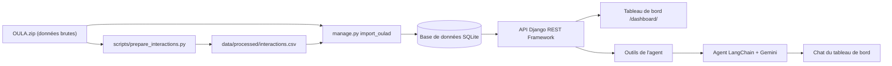

# OULA : analyse de la réussite et de l'engagement étudiant

OULA est un projet d'analyse de la réussite étudiante construit avec Django et l'
[Open University Learning Analytics Dataset (OULAD)](https://analyse.kmi.open.ac.uk/open_dataset).
Il organise les identités étudiantes, les présentations de cours, les inscriptions, les
évaluations et les interactions avec la plateforme d'apprentissage afin d'étudier l'engagement
et les résultats académiques, de repérer tôt les signaux de décrochage et d'interroger les
données en langage naturel.

Projet de groupe du cours *Développement Web en Python* (Master 2 Data Science), Projet 10 du
catalogue : un tableau de bord destiné à une équipe pédagogique.

## Statut du projet

| Flux de travail | Statut |
|---|---|
| Configuration et architecture du dépôt | Complet |
| Inspection OULAD et audit des valeurs manquantes | Complet (suivis d'audit documentés) |
| Préparation des interactions et réconciliation des comptes | Complet |
| Modèles Django, migrations, importation contrôlée | Complet, validé localement |
| API REST de consultation et d'analyse | Complet |
| Analyse de l'engagement et du taux de réussite par cours | Complet, validé (associations non causales) |
| Indicateurs de risque de décrochage | Complet : score à jour de coupure, avec vérification a posteriori |
| Tableau de bord interactif | Complet |
| Agent conversationnel fondé sur les données | Complet |
| Tests automatisés | Tous les tests passent |

## Ce que fait l'application

- **Importe** les données OULAD dans une base relationnelle (cours, étudiants, inscriptions,
  évaluations, interactions avec la plateforme).
- **Expose une API REST** (Django REST Framework) de consultation et d'analyse.
- **Calcule un score de risque de décrochage** transparent, avec les motifs en clair, et en
  vérifie la pertinence a posteriori.
- **Affiche un tableau de bord interactif** : réussite par module, engagement par semaine,
  corrélation engagement/résultat, étudiants à risque.
- **Répond en français à des questions** sur les données grâce à un agent LangChain qui
  interroge l'API.

## Architecture



Le tableau de bord et l'agent lisent **les mêmes endpoints** : leurs chiffres coïncident dès que
le périmètre (module, session) et la définition de l'indicateur sont identiques.

| Composant | Choix |
|---|---|
| Backend | Django 5.2 + Django REST Framework |
| Base de données | SQLite (développement) |
| Tableau de bord | Templates Django + Chart.js |
| Agent | LangChain (`create_agent`) + modèle Gemini, avec modèles de secours |
| Tests | Framework de tests de Django |

## Jeu de données

OULAD contient sept fichiers CSV liés : `studentInfo.csv`, `studentRegistration.csv`,
`courses.csv`, `assessments.csv`, `studentAssessment.csv`, `vle.csv` et `studentVle.csv`.

- [Page officielle du jeu de données](https://analyse.kmi.open.ac.uk/open_dataset)
- [Miroir Kaggle](https://www.kaggle.com/datasets/rocki37/open-university-learning-analytics-dataset)

Un cours de ce projet représente une **présentation de module**, identifiée par
`code_module` + `code_presentation`. Un étudiant peut être inscrit à plusieurs présentations.
Le fichier `studentVle.csv` contient plus de 10 millions de lignes : il est donc traité de
manière reproductible plutôt qu'en objets ORM individuels.

L'archive originale est conservée localement sous `data/raw/` et les interactions préparées
sous `data/processed/`. Aucun de ces dossiers n'est versionné.

### Modèles Django

| Modèle | Rôle |
|---|---|
| `Student` | Personne anonymisée identifiée par `id_student`, avec ses caractéristiques générales |
| `Course` | Présentation d'un module, identifiée de façon unique par `code_module` + `code_presentation` |
| `Enrollment` | Inscription d'un étudiant à une présentation : caractéristiques propres à l'inscription, décalages d'inscription et résultat final |
| `Assessment` | Métadonnées d'une évaluation et soumission/résultat d'un étudiant, liées à une inscription |
| `Interaction` | Clics agrégés au grain inscription + ressource de la plateforme + jour relatif |

`Enrollment` est nécessaire parce que les évaluations et les interactions appartiennent à une
présentation de cours particulière pour un étudiant donné, et non à l'identité de l'étudiant
seule. Voir [`docs/architecture.md`](docs/architecture.md),
[`docs/data-dictionary.md`](docs/data-dictionary.md) et [`docs/data-quality.md`](docs/data-quality.md).

### Préparation et validation des données

Le script de préparation laisse l'archive brute inchangée, supprime les lignes sources
strictement identiques et agrège les observations répétées étudiant-ressource-jour en
additionnant les clics.

Sur l'archive auditée : 10 655 280 lignes sources, dont 787 170 doublons exacts supprimés,
soit 9 868 110 lignes avant agrégation en **8 459 320 enregistrements d'interaction**. Le total
de clics importé en base (38 343 063) a été rapproché du total du fichier préparé.

La validation locale de l'import a enregistré : 22 cours, 28 785 étudiants, 32 593
inscriptions, 173 912 évaluations rendues et 8 459 320 interactions. Ces résultats valent pour
l'archive locale auditée : relancer la validation si les données sources ou les transformations
changent.

Décisions de qualité des données (détail dans
[`docs/data-quality-and-missing-values.md`](docs/data-quality-and-missing-values.md)) : un score
manquant n'est pas un zéro ; l'absence de date de désinscription n'est pas une preuve fiable
d'absence de retrait ; les dates OULAD sont des décalages relatifs en jours, pas des dates de
calendrier.

## Installation

Les commandes sont données pour Windows (PowerShell). Sous macOS ou Linux, activer
l'environnement avec `source .venv/bin/activate`.

1. **Cloner le dépôt** et créer l'environnement virtuel :
   ```
   git clone https://github.com/RosAI-27/OULA-DjangoProject.git
   cd OULA-DjangoProject
   python -m venv .venv
   .venv\Scripts\activate
   pip install -r requirements.txt
   ```
2. **Créer le fichier `.env`** à la racine du projet en copiant `.env.example`, puis le
   compléter (ce fichier ne doit jamais être commité) :
   ```
   DJANGO_SECRET_KEY=une_longue_chaine_aleatoire
   DJANGO_DEBUG=True
   DJANGO_ALLOWED_HOSTS=127.0.0.1,localhost

   GOOGLE_API_KEY=votre_cle_google_ai_studio
   LLM_MODEL=google_genai:gemini-3.8-flash
   LLM_MODELES_SECOURS=google_genai:gemini-3.5-flash-lite,google_genai:gemini-flash-latest
   ```
   Une clé secrète se génère avec :
   `python -c "import secrets; print(secrets.token_urlsafe(50))"`.
   La clé Google s'obtient gratuitement sur [Google AI Studio](https://aistudio.google.com).
   Les noms de modèles évoluent : en cas d'erreur `404`, vérifier la liste actuelle.
3. **Placer les données** (le dossier `data/` n'est pas versionné) : l'archive OULAD dans
   `data/raw/OULA.zip`. Elle doit contenir le dossier `anonymiseddata/` avec les fichiers CSV
   d'origine.
4. **Générer le fichier d'interactions** (depuis la racine du projet) :
   ```
   python scripts/prepare_interactions.py --input data/raw/OULA.zip --output data/processed/interactions.csv
   ```
5. **Créer la base et importer les données** (depuis le dossier `backend`) :
   ```
   cd backend
   python manage.py migrate
   python manage.py import_oulad
   ```
   L'import s'arrête si la base contient déjà des données. L'option `--replace` supprime les
   données existantes avant de recommencer (à utiliser avec précaution). L'import des
   interactions est long : compter plusieurs minutes.
6. **Lancer le serveur**, qui doit rester actif pour l'agent :
   ```
   python manage.py runserver
   ```
7. Ouvrir <http://127.0.0.1:8000/dashboard/>.

## API

Toutes les adresses sont préfixées par `/api/`.

### Consultation des données et analyses par cours

| Méthode | Adresse | Rôle |
|---|---|---|
| GET | `/courses/` | Liste des cours |
| GET | `/students/` | Liste des étudiants (anonymisés) |
| GET | `/enrollments/` | Inscriptions et résultats finaux |
| GET | `/assessments/` | Évaluations et notes |
| GET | `/analytics/success-rate-by-course/` | Taux de réussite par cours |
| GET | `/analytics/engagement-by-course/` | Engagement par cours |

Les filtres disponibles sont des paramètres d'adresse (par exemple `?final_result=Fail`) ; ils
sont décrits dans `backend/analytics/views.py`.

### Statistiques du tableau de bord, risque et agent

| Méthode | Adresse | Paramètres | Rôle |
|---|---|---|---|
| GET | `/stats/reussite-par-cours/` | `code_presentation` (optionnel) | Inscrits, taux de réussite et d'abandon par module |
| GET | `/stats/engagement-par-semaine/` | `code_module` (obligatoire), `code_presentation` | Clics par semaine de cours et par étudiant actif |
| GET | `/stats/engagement-par-resultat/` | `code_module` (obligatoire), `code_presentation` | Clics moyens et médians selon le résultat final |
| GET | `/etudiants-a-risque/` | `code_module` et `code_presentation` (obligatoires), `jour` (défaut 60), `niveau`, `limite` | Étudiants à risque avec score, niveau et motifs |
| GET | `/etudiants-a-risque/validation/` | `code_module` et `code_presentation` (obligatoires), `jour` | Compare chaque niveau de risque au résultat final réel |
| POST | `/agent/ask/` | corps JSON `{"question": "..."}` | Réponse de l'agent en français |

Exemples :

```
/api/stats/reussite-par-cours/?code_presentation=2013J
/api/etudiants-a-risque/?code_module=AAA&code_presentation=2013J&jour=60&niveau=eleve
```

Codes de réponse : `400` pour un paramètre manquant ou invalide, `502` si l'agent ne peut pas
joindre le modèle de langage.

### Définitions des indicateurs

Deux définitions du taux de réussite coexistent dans le projet. Elles répondent à deux
questions différentes et **ne sont pas directement comparables** :

| Endpoint | Définition |
|---|---|
| `/analytics/success-rate-by-course/` | Réussis (Pass + Distinction) divisés par les résultats **complétés** (Pass + Distinction + Fail). Les retraits sont rapportés séparément. |
| `/stats/reussite-par-cours/` (tableau de bord et agent) | Réussis (Pass + Distinction) divisés par **toutes** les inscriptions, retraits compris. Le taux d'abandon est la part de `Withdrawn`. |

Une absence d'interaction enregistrée n'est pas automatiquement une preuve de désengagement, et
la corrélation entre engagement et résultats n'établit pas de causalité.

## Score de risque de décrochage

Le score va de 0 à 100. Il est calculé **à un jour de coupure** (60 par défaut) à partir de ce
qui s'est passé jusqu'à ce jour, afin d'éviter toute fuite de la cible : le résultat final
(`final_result`) n'entre pas dans le calcul et sert uniquement à vérifier la pertinence du
score après coup.

| Signal | Points |
|---|---|
| Aucun clic sur la plateforme | 40 |
| Activité inférieure à celle du premier quart des étudiants du cours | 25 |
| Aucune activité sur les 14 jours précédant la coupure | 30 |
| Aucune évaluation rendue | 15 |
| Moyenne des notes inférieure à 40 | 30 |
| Moyenne des notes entre 40 et 55 | 15 |

Niveaux : **élevé** à partir de 60, **moyen** de 30 à 59, **faible** en dessous de 30. Les
étudiants désinscrits au plus tard le jour de coupure sont exclus de l'analyse.

> Le score est un **indicateur d'aide à la décision**, pas un verdict sur l'étudiant. Cet
> avertissement figure aussi dans l'interface.

### Vérification a posteriori

Module AAA, session 2013J, jour de coupure 60 (361 étudiants analysés) :

| Niveau | Étudiants | Échec ou abandon final |
|---|---|---|
| Élevé | 7 | 85,7 % |
| Moyen | 28 | 64,3 % |
| Faible | 326 | 18,1 % |
| Ensemble du cours | 361 | 23,0 % |

La part d'échecs ou d'abandons décroît régulièrement avec le niveau de risque. Limites de cette
vérification : un seul cours et un seul jour de coupure, effectifs faibles aux niveaux élevé et
moyen, et exclusion des étudiants déjà désinscrits au jour de coupure.

## Tableau de bord

Page `/dashboard/` :

- cartes de chiffres clés (tous modules) ;
- graphique de réussite et d'abandon par module ;
- courbe d'engagement par semaine pour le module choisi ;
- corrélation engagement / résultat final, avec une mise en garde : les étudiants qui abandonnent
  ont moins de temps pour cliquer, donc l'écart reflète en partie la durée de présence ;
- tableau des étudiants à risque, filtrable par jour de coupure et par niveau, avec la
  vérification a posteriori ;
- zone de chat avec l'assistant.

## Agent conversationnel

L'agent, construit avec LangChain, dispose de trois outils qui appellent l'API du projet :
réussite par cours, engagement par semaine et étudiants à risque. Il est instruit de ne répondre
qu'à partir des données renvoyées par ces outils, d'indiquer le périmètre de ses chiffres et de
demander une précision quand la question est incomplète.

Si le modèle principal est indisponible (surcharge, quota), l'agent essaie les modèles de
secours de `LLM_MODELES_SECOURS`. Les outils appellent le serveur local : l'adresse se modifie
avec la variable `API_BASE_URL` (par défaut `http://127.0.0.1:8000/api`).

Exemples de questions :

- « Quel module a le meilleur taux de réussite en 2013J ? »
- « Quels étudiants du module AAA en 2013J sont les plus à risque, et pourquoi ? »

## Tests

Depuis le dossier `backend` :

```
python manage.py test analytics
```

Les tests utilisent une base temporaire et de petites données fictives, et n'appellent pas le
modèle de langage. Ils couvrent l'API et les analyses par cours, les statistiques du tableau de
bord, le calcul et le classement du score de risque, l'exclusion des étudiants désinscrits, la
validation du score et la vérification des requêtes de l'agent.

## Principes de gestion des données, de vie privée et de modélisation

- Ne jamais commiter de secrets, de fichiers d'environnement locaux ni de données brutes au
  niveau des étudiants.
- Garder les fichiers sources bruts inchangés.
- Ne pas transformer les valeurs manquantes en zéro ou en catégorie inventée sans raison
  documentée.
- Prévenir la fuite de cible : les variables n'utilisent que l'information disponible au moment
  de la prédiction prévue.
- Établir une base simple et interprétable avant tout modèle complexe.
- Rapporter les dénominateurs, les limites et des indicateurs adaptés à la tâche.
- Traiter les indicateurs de risque comme des signaux incertains qui soutiennent une revue
  humaine, et non comme des décisions automatisées concernant les étudiants.

## Organisation du dépôt

```
OULA-DjangoProject/
├── backend/        Projet Django (config/) et application analytics/
├── data/
│   ├── raw/        Fichiers d'origine (exclu de Git)
│   └── processed/  Sorties générées (exclu de Git)
├── notebooks/      Exploration et expériences
├── docs/           Architecture, dictionnaire de données, décisions
├── reports/        Résultats d'analyses exportés en CSV
├── scripts/        Scripts reproductibles d'audit, de préparation et d'analyse
├── tests/          Notes sur les tests
├── .env.example    Modèle de variables d'environnement
├── .gitignore
├── requirements.txt
└── README.md
```

Documentation détaillée : [`docs/architecture.md`](docs/architecture.md),
[`docs/data-dictionary.md`](docs/data-dictionary.md),
[`docs/data-quality.md`](docs/data-quality.md),
[`docs/engagement-analysis.md`](docs/engagement-analysis.md) et
[`docs/api-dashboard-agent.md`](docs/api-dashboard-agent.md).

## Collaboration

Les changements importants passent par des branches de fonctionnalité et des *pull requests*,
relues par l'autre membre du groupe. `main` reste stable. Chaque membre commite sous son propre
compte GitHub : l'historique des commits fait foi.

## Dépannage

| Symptôme | Cause probable |
|---|---|
| `KeyError: 'DJANGO_SECRET_KEY'` au démarrage | Variable absente du fichier `.env` à la racine |
| `Bad Request (400)` dans le navigateur | `DJANGO_ALLOWED_HOSTS` ou `DJANGO_DEBUG` non renseignés |
| Migration non appliquée | Lancer `python manage.py migrate` |
| L'agent répond « Impossible de joindre l'API » | Le serveur Django n'est pas lancé |
| Erreur `503` ou `429` côté agent | Modèle Google surchargé ou quota gratuit atteint : réessayer ou changer de modèle |
| Erreur `404` sur un modèle | Nom de modèle périmé : consulter la liste sur Google AI Studio |

## Limites connues

- Le score de risque est une règle simple et transparente, pas un modèle prédictif entraîné. Il
  traite l'absence de clics comme un signal de risque, alors qu'une absence d'interaction n'est
  pas en soi une preuve de désengagement.
- Sa vérification porte sur un nombre limité de cours et de jours de coupure.
- Les endpoints de consultation n'exigent pas d'authentification.
- L'agent dépend d'un service externe dont la disponibilité et la vitesse ne sont pas garanties.
- OULAD est anonymisé et issu d'un seul établissement : les résultats ne se généralisent pas
  nécessairement à d'autres contextes.

## Répartition des rôles

| Membre | Responsabilités |
|---|---|
| BAPFUBUSA SIAPZE Rose | Modèles Django, import et qualité des données, API de consultation, analyses d'engagement et de réussite par cours |
| EBANGA MBALLA Télesphore | Endpoints d'agrégation, score de risque et sa validation, tableau de bord, agent conversationnel, tests |