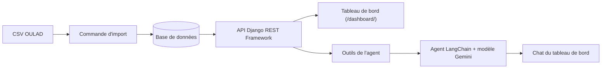

# API, tableau de bord et agent conversationnel

Cette page documente la partie « consultation » du projet : l'API d'analyse, le score de
risque de décrochage, le tableau de bord et l'agent conversationnel.

## Architecture



Le tableau de bord et l'agent lisent les **mêmes endpoints** : leurs chiffres coïncident
dès que le périmètre (module, session) est identique.

## Endpoints

| Méthode | Adresse | Paramètres | Rôle |
|---|---|---|---|
| GET | `/api/stats/reussite-par-cours/` | `code_presentation` (optionnel) | Inscrits, taux de réussite et d'abandon par module |
| GET | `/api/stats/engagement-par-semaine/` | `code_module` (obligatoire), `code_presentation` (optionnel) | Clics par semaine de cours, étudiants actifs, clics par étudiant actif |
| GET | `/api/etudiants-a-risque/` | `code_module` et `code_presentation` (obligatoires), `jour` (défaut 60), `niveau` (`eleve`, `moyen`, `faible`), `limite` (défaut 50) | Étudiants à risque avec score, niveau et motifs |
| POST | `/api/agent/ask/` | corps JSON `{"question": "..."}` | Réponse de l'agent en français |
| GET | `/api/stats/engagement-par-resultat/` | `code_module` (obligatoire), `code_presentation` (optionnel) | Clics moyens et médians selon le résultat final |

Exemples :

```
/api/stats/reussite-par-cours/?code_presentation=2013J
/api/stats/engagement-par-semaine/?code_module=AAA
/api/etudiants-a-risque/?code_module=AAA&code_presentation=2013J&jour=60&niveau=eleve
```

Codes de réponse : `400` pour un paramètre manquant ou invalide, `502` si l'agent ne peut
pas joindre le modèle de langage.

## Score de risque de décrochage

Le score va de 0 à 100. Il est calculé **à un jour de coupure** (60 par défaut), uniquement
à partir de ce qui s'est passé jusqu'à ce jour. Le résultat final (`final_result`) n'entre
pas dans le calcul : il sert seulement à vérifier a posteriori la pertinence du score.

| Signal | Points |
|---|---|
| Aucun clic sur la plateforme | 40 |
| Activité inférieure à celle du premier quart des étudiants du cours | 25 |
| Aucune activité sur les 14 jours précédant la coupure | 30 |
| Aucune évaluation rendue | 15 |
| Moyenne des notes inférieure à 40 | 30 |
| Moyenne des notes entre 40 et 55 | 15 |

Niveaux : **élevé** à partir de 60, **moyen** de 30 à 59, **faible** en dessous de 30.
Les étudiants désinscrits au plus tard le jour de coupure sont exclus de l'analyse.

> Le score est un indicateur d'aide à la décision, pas un verdict sur l'étudiant. Cet
> avertissement figure aussi dans l'interface.

## Tableau de bord

Page `/dashboard/` : cartes de chiffres clés (tous modules), graphique de réussite et
d'abandon par module, courbe d'engagement par semaine, tableau des étudiants à risque
(filtres jour de coupure et niveau) et zone de chat avec l'agent.

## Agent conversationnel

L'agent est construit avec LangChain (`create_agent`) et dispose de trois outils, qui
appellent les endpoints ci-dessus : réussite par cours, engagement par semaine, étudiants
à risque. Il est instruit de ne répondre qu'à partir des données renvoyées par ces outils.

Si le modèle principal est indisponible (surcharge, quota), l'agent essaie les modèles de
secours listés dans le fichier `.env`.

## Installation et lancement

1. Créer et activer l'environnement virtuel, puis installer les dépendances :
   ```
   python -m venv .venv
   .venv\Scripts\activate
   pip install -r requirements.txt
   ```
   Les bibliothèques utilisées par cette partie sont : `djangorestframework`, `requests`,
   `langchain`, `langchain-google-genai` et `python-dotenv`.
2. Copier `.env.exemple` en `.env`, puis ajouter (ne jamais commiter ce fichier) :
   ```
   GOOGLE_API_KEY=votre_cle
   LLM_MODEL=google_genai:gemini-3.8-flash
   LLM_MODELES_SECOURS=google_genai:gemini-3.5-flash-lite,google_genai:gemini-flash-latest
   ```
   Les noms de modèles évoluent : en cas d'erreur 404, vérifier la liste actuelle sur
   Google AI Studio.
3. Préparer et importer les données OULAD (les dossiers `data/` ne sont pas versionnés) :
   - placer l'archive du jeu de données dans `data/raw/OULA.zip` (elle doit contenir le
     dossier `anonymiseddata/` avec les fichiers CSV d'OULAD) ;
   - depuis la racine du projet, générer le fichier d'interactions :
     `python scripts/prepare_interactions.py --input data/raw/OULA.zip --output data/processed/interactions.csv`
   - depuis le dossier `backend`, importer dans la base : `python manage.py import_oulad`
   Si la base contient déjà des données, la commande s'arrête ; l'option `--replace`
   supprime les données existantes et relance l'import (à utiliser avec précaution).
4. Lancer le serveur, depuis le dossier `backend` :
   ```
   python manage.py runserver
   ```
   Il doit rester lancé pour l'agent, dont les outils appellent l'API du projet
   (adresse modifiable avec la variable `API_BASE_URL`).
5. Ouvrir http://127.0.0.1:8000/dashboard/

## Tests

```
python manage.py test analytics
```
Les tests (fichier `backend/analytics/test_api.py`) utilisent de petites données fictives et
n'appellent pas le modèle de langage. Ils vérifient les taux de réussite, l'engagement, le
calcul et le classement du score de risque, l'exclusion des étudiants désinscrits et la
validation des requêtes de l'agent.

## Limites

- Le score de risque est une règle simple et transparente, pas un modèle prédictif entraîné.
- L'agent dépend d'un service externe : sa disponibilité et sa vitesse ne sont pas garanties.
- Le jeu de données OULAD est anonymisé et issu d'un seul établissement.

## Répartition des rôles

| Membre | Responsabilités |
|---|---|
| EBANGA MBALLA Télesphore | Endpoints d'agrégation, score de risque, tableau de bord, agent, tests |
| BAPFUBUSA SIAPZE Rose Ange | Modèles Django, import et qualité des données, [à compléter] |