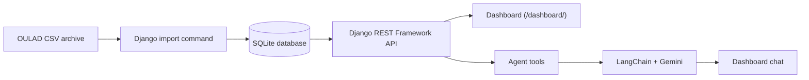

# API, Dashboard, and Conversational Agent

This document describes the application's data-consultation layer: the REST API, rule-based risk indicator, interactive dashboard, and conversational assistant.

## Architecture



The dashboard and agent call the same API endpoints. Their figures should agree when the module, presentation, cutoff, and metric definition are the same.

## Endpoints

All routes below are relative to `/api/`. The French route names and response keys are retained as existing API identifiers so the current dashboard and agent continue to work. They are not intended to indicate that the user interface is French.

| Method | Endpoint | Parameters | Purpose |
|---|---|---|---|
| GET | `stats/reussite-par-cours/` | Optional `code_presentation` | Enrollment-based success and withdrawal rates by module |
| GET | `stats/engagement-par-semaine/` | Required `code_module`; optional `code_presentation` | Weekly clicks, active enrollments, and clicks per active enrollment |
| GET | `stats/engagement-par-resultat/` | Required `code_module`; optional `code_presentation` | Mean and median clicks by final outcome |
| GET | `etudiants-a-risque/` | Required `code_module`, `code_presentation`; optional `jour` (default 60), `niveau`, `limite` (default 50) | Risk scores, levels, and reasons |
| GET | `etudiants-a-risque/validation/` | Required `code_module`, `code_presentation`; optional `jour` (default 60) | Retrospective comparison with final outcomes |
| POST | `agent/ask/` | JSON body: `{"question": "..." }` | Ask the conversational agent |
| GET | `courses/` | Filters and pagination parameters supported by the view | List course presentations |
| GET | `students/` | Filters supported by the view | List anonymized student records |
| GET | `enrollments/` | Filters supported by the view | List enrollments and final outcomes |
| GET | `assessments/` | Filters supported by the view | List assessment records |
| GET | `analytics/engagement-by-course/` | Optional module and presentation filters | Aggregate VLE activity by course presentation |
| GET | `analytics/success-rate-by-course/` | Pagination parameters | Success rate among completed outcomes |

Examples:

```text
/api/stats/reussite-par-cours/?code_presentation=2013J
/api/stats/engagement-par-semaine/?code_module=AAA
/api/etudiants-a-risque/?code_module=AAA&code_presentation=2013J&jour=60&niveau=eleve
```

A `400` response indicates invalid or missing request parameters. The agent endpoint can return `400` for an empty or overlong question and `502` when the agent cannot complete a request.

### Access control and pagination

The read-only list endpoints use Django REST Framework pagination. The current settings specify a default page size of 20. Do not rely on the earlier documentation's claim that student-level endpoints require authentication: the current project settings and views do not enforce authenticated default permissions. Treat the API as a development prototype until authentication and authorization are implemented and tested.

## Risk indicator

The risk indicator is a transparent additive rule, calculated using data up to a selected course-day cutoff (day 60 by default). The final outcome (`final_result`) is included in the response only for retrospective comparison; it is not an input to the score.

| Signal | Added points |
|---|---:|
| No recorded clicks up to the cutoff | 40 |
| Click activity below the course-level lower-quartile threshold | 25 |
| No recorded activity during the 14 days before the cutoff | 30 |
| No non-missing assessment score recorded by the cutoff | 15 |
| Mean recorded score below 40 | 30 |
| Mean recorded score from 40 to below 55 | 15 |

Risk levels are high (`eleve`) at 60 or more, medium (`moyen`) from 30 to 59, and low (`faible`) below 30.

**Scoring-scale note:** the current implementation adds points without an explicit clipping operation. However, the click-activity branches are mutually exclusive, as are the assessment-score branches. The maximum attainable total under the current rules is therefore 100 points. This is a heuristic point score, not a probability or percentage.

The current cohort query excludes enrollments with an unregistration date on or before the cutoff. It does not yet fully enforce that the registration date is present and on or before the cutoff. This is a known eligibility limitation; results should not be interpreted as a fully validated at-risk cohort.

The absence of a recorded score is not necessarily proof that no assessment was submitted: the implementation checks for a non-missing score among assessment records submitted by the cutoff. Likewise, no recorded VLE clicks do not prove that a student did not study elsewhere.

> The score is an exploratory decision-support indicator, not a verdict about a student. It should support human review, not automated decisions.

## Retrospective validation

The validation endpoint groups the scored enrollments by risk level and compares each group with the final outcome. In the documented example (module AAA, presentation 2013J, cutoff day 60), 361 enrollments were analyzed:

| Risk level | Enrollments | Final Fail or Withdrawn |
|---|---:|---:|
| High | 7 | 85.7% |
| Medium | 28 | 64.3% |
| Low | 326 | 18.1% |
| All analyzed enrollments | 361 | 23.0% |

The observed proportion of Fail or Withdrawn outcomes decreases across the risk levels in this example. This is a descriptive retrospective check, not proof of predictive performance. It covers one course presentation and one cutoff; the high- and medium-risk groups are small, so their percentages are sensitive to a few records. Enrollments already unregistered by the cutoff are excluded, so the overall 23.0% is not the course's total withdrawal rate.

## Dashboard

The dashboard is served at `/dashboard/` and includes:

- Overall enrollment, success-rate, and withdrawal-rate cards.
- Success and withdrawal rates by module.
- Weekly click activity for the selected module.
- Mean and median clicks by final outcome, with an exposure-time warning.
- A risk table with module, presentation, cutoff-day, and risk-level filters.
- A retrospective validation summary.
- A chat interface for the assistant.

The dashboard currently uses Chart.js from a CDN, so the browser needs internet access to load the chart library.

## Conversational agent

The LangChain agent is built with `create_agent` and has three tools that call the project API: success and withdrawal rates by course, weekly engagement, and students flagged by the risk indicator.

Its instructions require it to:
- Use only information returned by its tools for project figures.
- Ask for missing module or presentation context rather than guessing.
- Explain the reasons returned for risk flags.
- Treat risk scores as uncertain decision-support indicators.
- State clearly when an API tool returns an error or no data.

The primary model is attempted first, followed by the fallback models configured in `.env`. The agent requires a Google AI Studio API key and a running Django server. Its API base URL can be configured with `API_BASE_URL`.

## Setup and run

Follow the main [README installation instructions](../README.md#installation-and-local-run). In addition to the core project packages, the agent requires `requests`, `langchain`, and `langchain-google-genai`. The root `.env.example` is the environment template; do not use the old filename `.env.exemple`.

Example agent environment variables:

```dotenv
GOOGLE_API_KEY=your_google_ai_studio_key
LLM_MODEL=google_genai:YOUR_SUPPORTED_MODEL_ID
LLM_MODELES_SECOURS=google_genai:YOUR_FALLBACK_MODEL_ID
API_BASE_URL=http://127.0.0.1:8000/api
```

Model identifiers change over time. Use model names currently supported by Google AI Studio.

## Tests

From the `backend` directory:

```powershell
python manage.py test analytics
```

The tests use small synthetic records and do not call the external language model. They cover the course analytics endpoints, dashboard statistics, risk-score rules and ordering, cutoff-based exclusion, retrospective validation, and basic agent-request validation.

## Limitations

- The risk indicator is a hand-designed rule, not a trained predictive model.
- Registration-date eligibility is not fully enforced in the current risk cohort.
- The score is a heuristic point total, not a calibrated probability.
- The retrospective check covers one course presentation and one cutoff.
- The agent depends on an external model provider and a running local API.
- The current API does not enforce authentication or authorization.
- OULAD is anonymized and comes from one institution; results may not generalize to other settings.

## Team responsibilities

| Team member | Main responsibilities |
|---|---|
| EBANGA MBALLA Télesphore | Aggregation endpoints, risk indicator and retrospective validation, dashboard, conversational agent, and tests |
| BAPFUBUSA SIAPZE Rose Ange | Django models, data import and quality, consultation API, and course-level engagement and success analysis |
